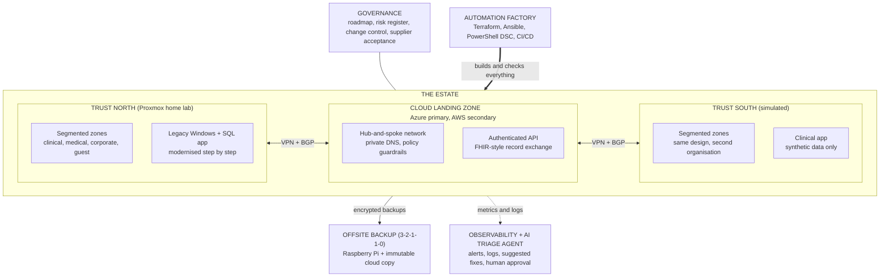
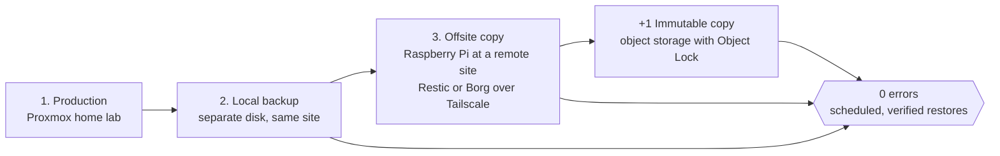
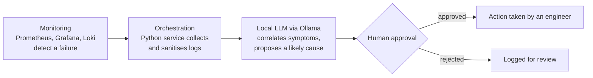
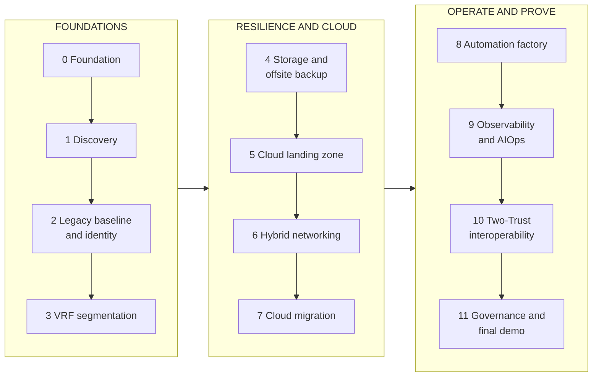

# NHF ResilienceLab 2.0

**Modernising legacy infrastructure into a secure, automated hybrid cloud: a two-Trust resilience and integration proof of concept.**


> Two simulated health organisations, **Trust North** and **Trust South**, have agreed to align strategically.
> This lab builds, secures, automates, monitors and recovers the infrastructure that alignment depends on,
> then proves each layer works with tests before anything is merged.
>
> All organisations, networks and clinical records in this repository are **synthetic**. Nothing here represents a real organisation or contains real data.

---

## Why this project exists

Health technology is improving exponentially. Connected devices, shared records, cloud services and AI-assisted tools arrive faster than any single organisation can absorb them, so health Trusts increasingly align to share capability and deliver more joined-up care.

That alignment has a price. Every new connection, shared service and cloud dependency widens the attack surface, and a weakness in one Trust can become a weakness in its partner. **Synergy is only worth having if it is built to be resilient.**

### The problems this lab tackles

| Problem | What the lab builds in response |
|---|---|
| Ageing infrastructure that is hard to patch, recover and defend | A realistic legacy estate, then a tested, staged modernisation |
| Flat networks where one compromise reaches everything | VRF segmentation with default-deny policy between zones |
| Partner Trusts need to exchange data without exposing each other | An authenticated, audited, FHIR-style API as the *only* path between them |
| Backups that are untested or stored in one place | 3-2-1-1-0 backup with an offsite node, an immutable copy and verified restores |
| Hand-built systems that drift and cannot be audited | Everything defined as code, rebuilt from the pipeline, checked for drift |
| Slow fault diagnosis while clinical services wait | Observability plus an AI triage agent that drafts a cause, with a human approving any action |

### The benefits

- **Resilience:** services survive faults, attacks and site loss, and recovery is *proven by test*, not assumed.
- **Improved healthcare delivery:** dependable systems and safer record sharing mean care is not delayed by systems that cannot talk to each other.
- **Resource optimisation:** shared patterns, automation and cloud elasticity cut manual effort and duplicated spend.
- **Lower shared cyber risk:** alignment is built on segmentation, authentication and assurance, not on trust alone.

---

## Architecture



### Design principles

1. **Segment first.** Every zone is a separate routing domain. Cross-zone traffic is explicitly allowed, never assumed.
2. **One door between Trusts.** The authenticated API is the only permitted path for clinical data. No network shortcuts.
3. **Everything as code.** If it cannot be rebuilt from the repository, it is not finished.
4. **Prove it.** Every phase has pass and fail tests written *before* the build, and evidence saved after.
5. **AI assists, humans decide.** The triage agent has read-only tools and is kept out of the clinical-data path entirely.

---

## Technology stack

| Layer | Technologies |
|---|---|
| **Governance** | Architecture decision records, RACI, change control, DSPT-style evidence mapping (illustrative), supplier acceptance criteria |
| **Observability and AIOps** | Prometheus, Grafana, Loki, SLIs and SLOs, alerting, local LLM triage agent (Ollama, Python, FastAPI, Pydantic) |
| **Automation** | Terraform, Ansible, PowerShell DSC, GitHub Actions, drift detection |
| **Identity and security** | Active Directory, Entra ID and RBAC, MFA, secrets management, firewall policy, Azure Policy guardrails, Key Vault, Defender for Cloud |
| **Network** | VRF-Lite with FRRouting, OSPF, BGP, hub-and-spoke VNet and VPC, site-to-site VPN, private DNS |
| **Compute, data and backup** | Proxmox, Windows Server, SQL Server, Proxmox Backup Server, Restic or Borg, Tailscale, object storage with immutability (WORM) |
| **Interoperability** | FHIR-style REST API, UK Core-aligned profiles, OAuth 2.0 and mutual TLS, audit logging |

---

## Resilience by design: 3-2-1-1-0 backup



Every copy is proven by a scheduled **restore test**, not just a completed backup job. Missed backups raise an alert. Encryption keys are stored separately from the data they protect.

---

## AI-assisted incident triage (Phase 9)



Guardrails that make this safe to demonstrate:

- The agent has **read-only** tools. It cannot change anything.
- Logs are **sanitised** before reaching the model, so no credentials or identifiers leave the pipeline.
- Model output is **schema-validated** before it is shown to anyone.
- Any disruptive action requires **explicit human sign-off**.
- The agent is **deliberately excluded** from the clinical-data exchange path.

---

## Delivery roadmap

Delivered in twelve phases. Each phase is built on a feature branch, tested, evidenced and only then merged to `main` and tagged.



| Phase | Focus | Release tag | Status |
|---|---|---|---|
| 0 | Engineering foundation: repo, CI, secret scanning, branch protection | `v0.1-foundation` | In progress |
| 1 | Discovery: CMDB, dependency map, criticality, migration options | `v0.2-discovery` | Planned |
| 2 | Legacy baseline: AD, DNS, DHCP, GPO, SQL, synthetic clinical app, baseline metrics | `v0.3-legacy-baseline` | Planned |
| 3 | VRF segmentation: isolated zones, default-deny policy, regression tests | `v0.4-vrf-segmentation` | Planned |
| 4 | Storage and offsite backup: 3-2-1-1-0, Raspberry Pi, immutable copy, restore drills | `v0.5-backup` | Planned |
| 5 | Cloud landing zone: Terraform, identity, hub-and-spoke, guardrails as code | `v0.6-landing-zone` | Planned |
| 6 | Hybrid networking: site-to-site VPN, BGP, private DNS | `v0.7-hybrid-network` | Planned |
| 7 | Cloud migration: replication, cutover, rehearsed rollback | `v0.8-migration` | Planned |
| 8 | Automation factory: Ansible, DSC, pipelines, drift detection | `v0.9-automation` | Planned |
| 9 | Observability and AIOps: SLOs, dashboards, AI triage agent | `v0.10-observability` | Planned |
| 10 | Two-Trust interoperability: authenticated FHIR-style exchange | `v0.11-interop` | Planned |
| 11 | Governance, benefits report and end-to-end demonstration | `v1.0` | Planned |

There is no fixed finish date. The aim is to understand and be able to rebuild every layer from memory, not to rush a demo.

---

## Engineering standards

This repository is run the way a production platform should be.

- **Nothing reaches `main` without a pull request** and passing required checks (lint and secret scan).
- **Pre-commit hooks** lint files and block secrets *before a commit exists*; the pipeline repeats the checks as a second line of defence.
- **Tests are written first**, then the build. Earlier phases' tests are re-run after every later phase to catch regressions.
- **Evidence is saved** in `evidence/phase-N/` so every claim can be checked.
- **Rollback is written before the change**, and rehearsed for risky steps.
- **No secrets, keys or real data** are ever committed.

---

## What this project demonstrates

| Capability | How it is shown |
|---|---|
| Infrastructure modernisation | Legacy Windows and SQL estate migrated to cloud with measured before-and-after results |
| Network engineering | VRF-Lite, OSPF, BGP, site-to-site VPN, hub-and-spoke, private DNS |
| Cloud engineering (Azure and AWS) | Landing zones, RBAC, policy guardrails, secure hybrid connectivity |
| Infrastructure as Code and automation | Terraform, Ansible, PowerShell DSC, CI/CD with drift detection |
| Security by design | Segmentation, least privilege, secrets management, immutable backups |
| Resilience and disaster recovery | 3-2-1-1-0 backup with verified restores and recorded RTO and RPO |
| Observability and SRE practice | Prometheus, Grafana, Loki, SLIs and SLOs, actionable alerting |
| Applied AI, responsibly | Local LLM triage with read-only tools, validation and human approval |
| Interoperability | Authenticated FHIR-style exchange between two organisations |
| Governance and documentation | ADRs, RACI, change control, supplier acceptance, benefits realisation |

---

## Repository layout

| Folder | Purpose |
|---|---|
| `docs/` | Plans, decisions, runbooks, resource and IP plans |
| `network/` | Routing and segmentation |
| `windows/` | Windows Server, identity, SQL |
| `cloud/` | Cloud landing zone and migration |
| `automation/` | Ansible, DSC, pipelines |
| `observability/` | Monitoring and AI triage |
| `backup/` | Backup and restore |
| `tests/` | Test scripts for every phase |
| `evidence/` | Saved proof that tests passed |

## Following along

```bash
git clone git@github.com:adeolu-rabiu/resiliencelab.git
cd resiliencelab
pip install pre-commit && pre-commit install
```

Each phase has a release tag. Check out a tag to see the repository exactly as it stood when that phase passed its tests.

---

## About the author

**Adeolu Rabiu** is an infrastructure and cloud engineer with 16+ years across telecoms, energy, cloud engineering and education-sector IT. He holds an MSc in Operations Management (Distinction, University of Salford) and a BSc in Physics with Electronics, with AWS Cloud Practitioner, CCNA and Certified Scrum Master certifications. He has deep hands-on experience in homelab development, GitOps, observability stacks and Kubernetes.


### Get in touch

| | |
|---|---|
| **Email** | adeolu.rabiu@gmail.com |
| **Phone** | `+447578928667` |
| **LinkedIn** | `https://www.linkedin.com/in/adeolurabiu` |
| **GitHub** | [adeolu-rabiu](https://github.com/adeolu-rabiu) |

I am open to conversations about infrastructure modernisation, automation engineering and cloud roles.

---

## Licence and disclaimer

Released under the MIT licence. This is a personal lab project run independently of any employer. All subnets, organisations, applications and records are synthetic lab constructs; compliance mappings are illustrative only.
